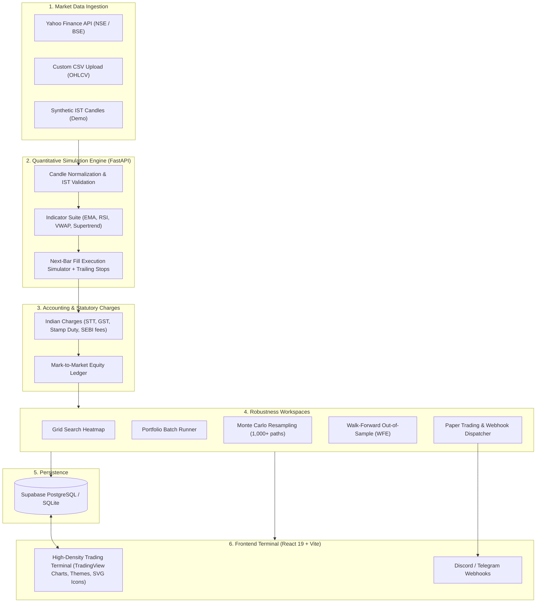

# Strategy Lab — Quantitative Research & Backtesting Workspace for Indian Markets

[](https://render.com/deploy?repo=https://github.com/krishnagarg-2004/strategy-lab-mvp)
[](https://fastapi.tiangolo.com)
[](https://react.dev)
[](https://www.docker.com)
[](https://supabase.com)
[](https://www.python.org)

**Strategy Lab** is an institutional-grade quantitative backtesting laboratory and research terminal built for Indian equities and indices (NSE / BSE). 

Features include zero look-ahead bias execution, multi-indicator filtering (EMA, VWAP, Supertrend, RSI), accurate Indian statutory charges modeling (STT, GST, Stamp Duty, SEBI turnover fees), parameter optimization heatmaps, multi-stock portfolio testing, Monte Carlo sequence risk stress testing, Walk-Forward out-of-sample validation, and live forward paper trading with Discord/Telegram alert webhooks.

> 📘 **Looking for step-by-step trader instructions?**  
> Check out the **[User Guide & Trader Handbook](USER_GUIDE.md)** for indicator setup, metric interpretations, and webhook guides.

---

## 📑 Table of Contents

1. [Live Cloud Access](#-live-cloud-access)
2. [Architecture](#-architecture)
3. [Key Capabilities](#-key-capabilities)
4. [Project Structure](#-project-structure)
5. [Quick Start Guide](#-quick-start-guide)
   * [Docker Compose (Recommended)](#docker-compose-recommended)
   * [Local Development](#local-development)
6. [Environment Variables](#-environment-variables)
7. [Quantitative Methodology & Risk Metrics](#-quantitative-methodology--risk-metrics)
8. [API Reference](#-api-reference)
9. [CSV Upload Specification](#-csv-upload-specification)
10. [Testing](#-testing)
11. [Disclaimers & License](#-disclaimers--license)

---

## 🌐 Live Cloud Access

| Service | Component | Access Link | Description |
| :--- | :--- | :--- | :--- |
| **Frontend Web App** | React 19 + TypeScript | [https://strategy-lab-frontend.onrender.com](https://strategy-lab-frontend.onrender.com) | Web workstation with TradingView charts, light/dark themes, and real-time ticker tape |
| **Backend API** | FastAPI Service | [https://strategy-lab-backend-dj9l.onrender.com](https://strategy-lab-backend-dj9l.onrender.com) | Event-driven backtesting engine, quantitative analytics, and REST API |
| **API Documentation** | Swagger UI | [https://strategy-lab-backend-dj9l.onrender.com/docs](https://strategy-lab-backend-dj9l.onrender.com/docs) | Interactive API exploration and JSON schemas |
| **Database** | Managed PostgreSQL | Supabase Cloud Pooler | Persistent store for experiments with automatic local SQLite fallback |

---

## 🔄 Architecture



---

## ⚡ Key Capabilities

### 1. Strategy Engine & Realistic Execution
- **Multi-Indicator Rules**: Configurable Fast/Slow EMA crossovers, Intraday VWAP (09:15 IST daily reset), Supertrend (ATR bands), and RSI momentum filters.
- **Bi-Directional Execution**: Long Only, Short Only, or Both directions.
- **Strict Execution Realism**: Zero look-ahead bias (signals generated on bar close, filled on subsequent bar open), conservative intrabar stop/target checks, and configurable basis-point slippage.
- **Dynamic Risk Management**: Percentage-based stop-loss, take-profit, and peak-trailing stop ratchets.

### 2. Indian Statutory Taxation & Brokerage
Accurately models net trading returns by deducting:
- **Securities Transaction Tax (STT)**: 0.025% on intraday equity sell turnover.
- **Brokerage**: Flat per-order fee (e.g., ₹20 standard).
- **Goods and Services Tax (GST)**: 18% on brokerage and turnover fees.
- **Exchange & SEBI Charges**: Regulatory turnover fees.
- **Stamp Duty**: State stamp duties on buy turnover.

### 3. Quantitative Analysis Modules
- **Parameter Grid Search**: 2D heatmaps across Fast $\times$ Slow EMA combinations to identify stable parameter plateaus and avoid curve-fitting.
- **Multi-Stock Portfolio Batch**: Run batch backtests across NIFTY 50, BANK NIFTY, and custom stock baskets simultaneously.
- **Monte Carlo Sequence Risk**: Reshuffles trade returns across 1,000+ iterations to compute drawdown confidence intervals (95th, 75th, 50th, 25th, 5th percentiles) and Risk of Ruin.
- **Walk-Forward Validation (OOS)**: Chronologically partitions data into In-Sample and Out-of-Sample windows to calculate Walk-Forward Efficiency (WFE %).
- **Live Paper Trading & Webhook Alerts**: Forward simulated execution with live tick evaluation and formatted Discord/Telegram webhook dispatches.
- **Watchlist & Live Ticker Strip**: 80+ curated Indian equities and indices with sector presets, live LTP quotes, day changes, and integrated TradingView chart modals.

---

## 📂 Project Structure

```text
strategy-lab-mvp/
├── backend/
│   ├── app/
│   │   ├── db.py                 # PostgreSQL / SQLite auto-fallback database connection
│   │   ├── engine.py             # Quantitative backtest engine, grid search, MC, and WFO
│   │   ├── main.py               # FastAPI routers and lifespan setup
│   │   ├── market_data.py        # Market data fetcher and stock catalog
│   │   ├── models.py             # SQLAlchemy models for saved experiments
│   │   ├── paper_trading.py      # Paper trading runner and webhook dispatchers
│   │   ├── schemas.py            # Pydantic v2 validation schemas
│   │   └── taxes.py              # Indian statutory charges engine (STT, GST, SEBI)
│   ├── tests/                    # Pytest test suite (37 passing tests)
│   ├── Dockerfile                # Production backend container build
│   └── requirements.txt          # Backend dependencies
├── frontend/
│   ├── src/
│   │   ├── components/           # UI components (Watchlist, AIChatDrawer, AuthModal, etc.)
│   │   ├── App.tsx               # Main terminal workspace and router
│   │   ├── CandlestickChart.tsx  # TradingView Lightweight-Charts integration
│   │   └── styles.css            # Institutional design tokens & styles
│   ├── Dockerfile                # Production frontend container build
│   └── package.json              # Frontend dependencies (React 19, Lucide, Recharts)
├── docker-compose.yml            # Multi-container local orchestration
├── render.yaml                   # 1-Click Render deployment configuration
├── USER_GUIDE.md                 # Practical user guide for traders
└── README.md
```

---

## 🚀 Quick Start Guide

### Docker Compose (Recommended)

```bash
# Clone the repository
git clone https://github.com/krishnagarg-2004/strategy-lab-mvp.git
cd strategy-lab-mvp

# Build and start all services
docker compose up --build
```

- **Frontend UI**: [http://localhost:5173](http://localhost:5173)
- **Backend API Docs**: [http://localhost:8001/docs](http://localhost:8001/docs)
- **PostgreSQL**: `localhost:5433` (maps to internal `5432`)

To shut down: `docker compose down`

---

### Local Development

#### 1. Backend Setup
```bash
cd backend
python -m venv .venv

# Windows:
.venv\Scripts\Activate.ps1
# macOS/Linux:
source .venv/bin/activate

pip install -r requirements.txt
uvicorn app.main:app --reload --port 8000
```
*Backend runs on `http://localhost:8000` (auto-falls back to SQLite if PostgreSQL is not active).*

#### 2. Frontend Setup
```bash
cd frontend
npm install
npm run dev
```
*Frontend runs on `http://localhost:5173`.*

---

## ⚙️ Environment Variables

| Variable | Scope | Default | Description |
| :--- | :--- | :--- | :--- |
| `DATABASE_URL` | Backend | `sqlite:///./strategy_lab.db` | PostgreSQL connection string. Falls back to SQLite if unreachable. |
| `VITE_BACKEND_URL` | Frontend | `''` | Explicit backend URL for remote deployment. In local dev, Vite proxies `/api` to backend. |
| `GROQ_API_KEY` | Backend | `None` | (Optional) Enables Groq-accelerated AI strategy natural language compilation. |
| `GEMINI_API_KEY` | Backend | `None` | (Optional) Fallback AI model provider for natural language strategy translation. |

---

## 📐 Quantitative Methodology & Risk Metrics

Strategy Lab computes standard institutional risk statistics:

### 1. Annualized Sharpe Ratio
$$\text{Sharpe Ratio} = \frac{\bar{R}_p - R_f}{\sigma_p} \times \sqrt{252}$$
- $\bar{R}_p$: Mean trade return.
- $R_f$: Benchmark risk-free rate (defaults to 6.5% RBI repo rate).
- $\sigma_p$: Sample return standard deviation.

### 2. Annualized Sortino Ratio
Penalizes downside volatility only:
$$\text{Sortino Ratio} = \frac{\bar{R}_p - R_f}{\sigma_{\text{downside}}} \times \sqrt{252}, \quad \sigma_{\text{downside}} = \sqrt{\frac{1}{N} \sum_{i=1}^{N} \min(0, R_i - \text{MAR})^2}$$

### 3. Profit Factor & Maximum Drawdown (MDD)
$$\text{Profit Factor} = \frac{\sum \text{Profits}}{\sum |\text{Losses}|}, \qquad \text{MDD} = \max_{t} \left( \frac{\text{Peak}_t - \text{Equity}_t}{\text{Peak}_t} \right) \times 100\%$$

### 4. Walk-Forward Efficiency (WFE %)
$$\text{WFE} = \left( \frac{\text{Annualized Return}_{\text{Out-of-Sample}}}{\text{Annualized Return}_{\text{In-Sample}}} \right) \times 100\%$$
- $\text{WFE} \ge 60\%$: Strategy demonstrates robust out-of-sample edge.
- $\text{WFE} < 40\%$: Strategy indicates potential curve-fitting.

---

## 🛠️ API Reference

Interactive Swagger documentation is available at `/docs`.

| Method | Endpoint | Description |
| :--- | :--- | :--- |
| `POST` | `/api/backtest` | Executes a single strategy backtest with trade ledger and metrics |
| `POST` | `/api/market-data/fetch` | Fetches historical OHLCV candles from Yahoo Finance |
| `POST` | `/api/market-data/quotes` | Fetches latest quotes & day change for live ticker tape |
| `POST` | `/api/grid-search` | Performs 2D parameter sweep with in-memory candle caching |
| `POST` | `/api/portfolio-backtest` | Runs batch backtest across a multi-stock watchlist |
| `POST` | `/api/monte-carlo` | Resamples trade returns across 1,000+ paths for sequence risk |
| `POST` | `/api/walk-forward` | Evaluates In-Sample vs Out-of-Sample Walk-Forward Efficiency |
| `POST` | `/api/paper-trading/start` | Initializes a live simulated paper trading session |
| `POST` | `/api/paper-trading/tick` | Evaluates simulated ticks against strategy rules & trailing stops |
| `POST` | `/api/paper-trading/webhook-test` | Sends formatted test alert to Discord or Telegram webhooks |
| `GET` | `/api/experiments` | Lists saved backtest runs from database |
| `POST` | `/api/experiments` | Saves a backtest experiment |
| `DELETE` | `/api/experiments/{id}` | Deletes a saved backtest experiment |

---

## 📊 CSV Upload Specification

Custom historical market data can be uploaded in CSV format with the following columns:

| Column | Type | Description | Example |
| :--- | :--- | :--- | :--- |
| `timestamp` | String / ISO 8601 | Candle date-time (IST supported) | `2026-03-01T09:15:00` |
| `open` | Float | Opening price | `2450.50` |
| `high` | Float | Session high | `2465.00` |
| `low` | Float | Session low | `2448.20` |
| `close` | Float | Closing price | `2460.10` |
| `volume` | Float / Int | Traded volume | `125400` |

---

## 🧪 Testing

The backend test suite covers backtest simulation, indicator logic, statutory taxation calculations, AI parsing, and community API endpoints:

```bash
cd backend
pytest -v tests
```

---

## ⚠️ Disclaimers & License

1. **Simulation Only**: Strategy Lab is an educational and research platform. It does not place real orders or execute real financial trades.
2. **Backtesting vs Reality**: Historical backtesting results and simulations do not guarantee future profitability in live market conditions.

Distributed under the MIT License. See [LICENSE](LICENSE) for details.
